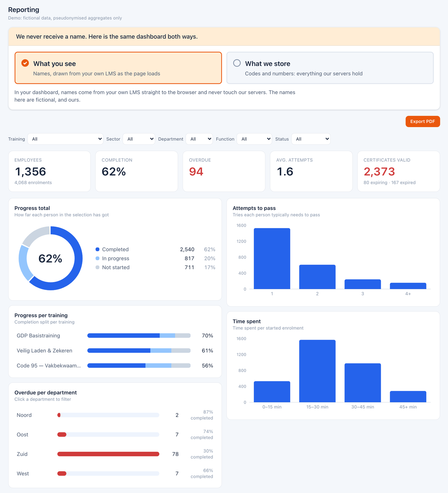
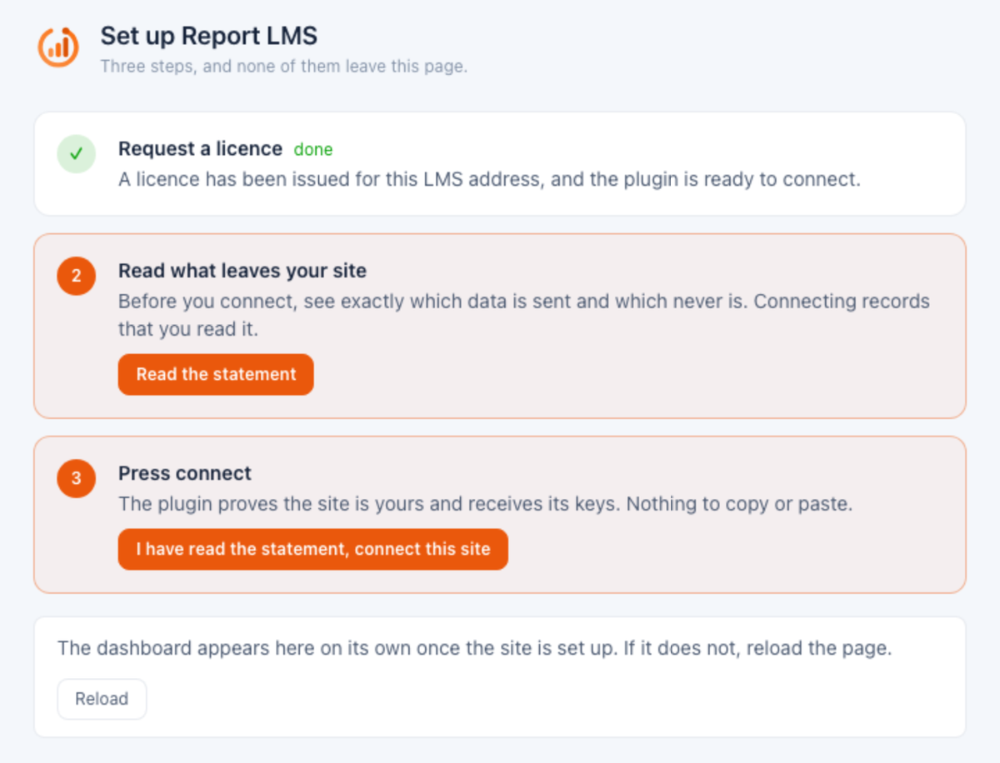

  

# Report LMS for Moodle

Connect your Moodle site to [Report LMS](https://reportlms.com) for clear training
dashboards: completion, overdue training, attempts, time spent and certificates,
per department.

Learner data leaves your site as codes and numbers only. Names never do: the
dashboard adds them in the manager's browser, straight from your own Moodle.

## Features

- Dashboard inside Moodle with completion, overdue, attempts and certificate figures.
- Progress per training, attempts to pass, time spent and overdue per department.
- Filters on training, department, profile fields and status.
- PDF export for audits and management reports.
- Organisation structure with departments, units and a manager per unit.
- Managers only see the people in their own part of the organisation.
- Certificate expiry tracking for Moodle Workplace and `mod_customcert`.
- One-click connection with clear status, reconnect and disconnect controls.
- Optional front page block that links to the dashboard.

## Requirements

- Moodle **4.5, 5.0 or 5.1** and PHP **8.1+**, using a PHP version supported by your Moodle release.
- A Report LMS free trial or subscription (see [Pricing](#pricing)), outbound HTTPS
  access and working Moodle cron.

## Pricing

The plugin itself is free and open source. The dashboards are served by the
Report LMS service at [reportlms.com](https://reportlms.com), which needs a licence
for your site address:

- **Free trial**: 7 days, up to 100 users, no payment details. Request it in the
  first setup step or on [reportlms.com/pricing](https://reportlms.com/pricing).
- **Subscription**: after the trial, one plan per site, priced by the number of
  users, monthly or yearly. Every plan has the same features. See
  [reportlms.com/pricing](https://reportlms.com/pricing).

When a site has more people than its plan covers, reports show the people who joined
the site first. For the others, only a coded id, the account status and login method
(and any unit they manage) are sent, no learning data, until the plan grows. Site
administrators take no place. The plugin's settings page shows the numbers.

## Install and connect

1. Install through **Site administration → Plugins → Install plugins**.
2. Visit **Site administration** to complete the installation or upgrade.
3. Open **Plugins → Local plugins → Report LMS** and follow the three setup steps:
   - **Request a licence** for your site address.
   - **Read what leaves your site**: the statement shows exactly which data is sent
     and which never is.
   - **Press connect**. The plugin proves the site is yours and receives its keys,
     there is nothing to copy or paste.
4. Set up your organisation: add departments and place people in them.
5. Give managers access by naming them as manager of a unit, or grant
   `local/reportlms:view` to a role.

  

For manual installation, place the plugin in `local/reportlms` on Moodle 4.5 and 5.0,
or `public/local/reportlms` on Moodle 5.1.

Data is sent by cron. **Disconnect** stops all sending. **Reconnect** verifies the
site again, also when the previous key expired or was lost.

## Privacy

Report LMS never receives learner names, email addresses or other free text. Learner ids
are coded with a key that stays on your Moodle site, so only your site can link a
code back to a person. Results are sent as numbers and dates.

The one personal detail that is sent is the contact email a site administrator
gives for licence and service messages. It is used only for those messages and is
never linked to the figures.

Everything the plugin stores and sends is declared through the Moodle Privacy API.

## Support and license

Report problems through [GitHub issues](https://github.com/LdesignMedia/moodle-local_reportlms/issues).
Learn more at [reportlms.com](https://reportlms.com).

Licensed under [GNU GPL v3 or later](LICENSE).
